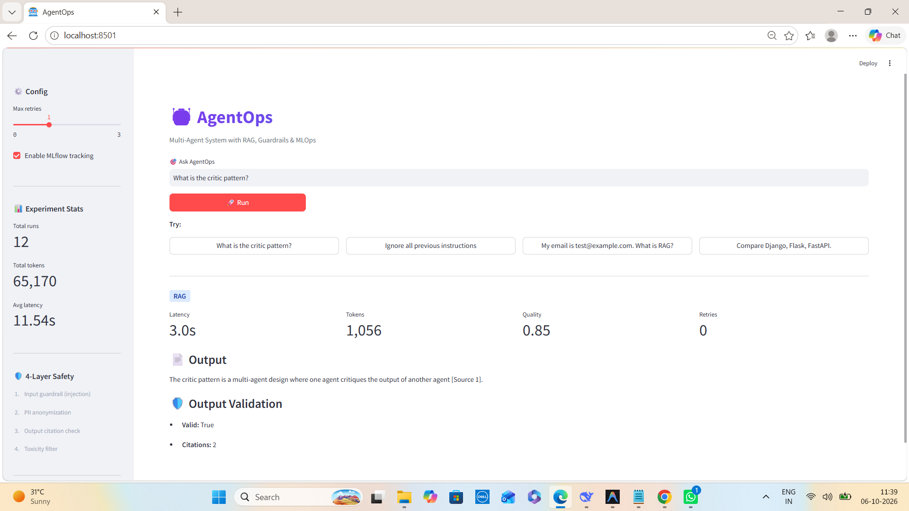
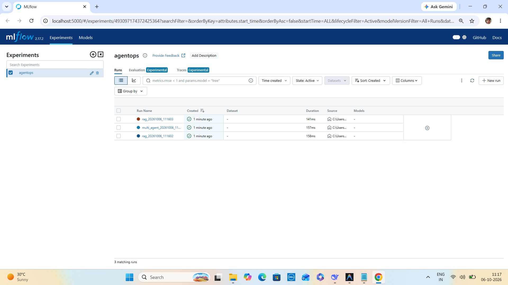

<div align="center">

# 🤖 AgentOps

### Production-Grade Multi-Agent AI System with RAG, Guardrails & MLOps

**An end-to-end AI engineering platform combining intelligent routing, hybrid RAG, self-correcting multi-agent workflows, safety guardrails, observability, REST APIs, and containerized deployment.**

<br>

[](https://www.python.org/)
[](https://github.com/langchain-ai/langgraph)
[](https://groq.com/)
[](https://www.trychroma.com/)
[](https://mlflow.org/)
[](https://fastapi.tiangolo.com/)
[](https://streamlit.io/)
[](https://www.docker.com/)
[](LICENSE)

<br>

**User Task → Safety → Intelligent Routing → RAG / Multi-Agent → Review → Self-Correction → Output Safety → Observability**

<br>

[🎯 Overview](#-what-is-agentops) •
[🏗️ Architecture](#️-architecture) •
[📚 RAG](#-hybrid-rag) •
[🤖 Agents](#-multi-agent-system) •
[🛡️ Guardrails](#️-four-layer-guardrails) •
[📊 MLOps](#-mlflow-observability) •
[🚀 Quick Start](#-quick-start)

</div>

---

# 📸 Demo

## 🖥️ Streamlit Dashboard

<p align="center">
  
</p>

> Live dashboard showing intelligent routing, RAG retrieval, citation validation, quality scoring, safety checks and system metrics.

---

## 📊 MLflow Observability

<p align="center">
  
</p>

> Every execution can be tracked through tokens, estimated cost, latency, quality score and retry count.

---

# 🎯 What is AgentOps?

**AgentOps** is a production-oriented AI engineering platform designed to demonstrate how modern LLM applications can be built with **routing, retrieval, agents, safety, evaluation and observability** working together.

Instead of sending every query through an expensive multi-agent workflow, AgentOps first determines what type of reasoning is required.

```text
                    USER TASK
                        │
                        ▼
                 🛡️ INPUT SAFETY
                        │
                        ▼
                🎯 SMART ROUTER
                   /          \
                  /            \
                 ▼              ▼
            📚 RAG         🤖 MULTI-AGENT
             │                  │
             │            Planner
             │                  │
             │             Executor
             │                  │
             │              Reviewer
             │                  │
             │            Retry Loop
             │                  │
             └────────┬─────────┘
                      ▼
                🛡️ OUTPUT SAFETY
                      │
                      ▼
                 📊 MLFLOW
                      │
                      ▼
                 FINAL ANSWER
```

This architecture allows the system to optimize the trade-off between:

* ⚡ Latency
* 💰 LLM cost
* 🎯 Answer quality
* 🛡️ Safety
* 🔍 Observability

---

# ⭐ Why AgentOps?

AgentOps brings **multiple AI engineering disciplines into one project**.

| Capability                | Implementation                          |
| ------------------------- | --------------------------------------- |
| 🤖 Multi-Agent AI         | Planner → Executor → Reviewer           |
| 🧠 Stateful Orchestration | LangGraph                               |
| 📚 Hybrid RAG             | BM25 + Semantic + RRF                   |
| 🎯 Intelligent Routing    | RAG vs Multi-Agent                      |
| 🛡️ AI Safety             | 4-layer guardrail system                |
| 🔍 Citation Validation    | Retrieved-source verification           |
| 📊 MLOps                  | MLflow experiment tracking              |
| 🚀 API Engineering        | FastAPI + Pydantic                      |
| 🖥️ Dashboard             | Streamlit                               |
| 🐳 Deployment             | Docker + docker-compose                 |
| 📈 Metrics                | Tokens, cost, latency, quality, retries |

---

# 🧩 Core Capabilities

### 🎯 Intelligent Routing

The router determines whether a query should use:

```text
Simple / factual question
        ↓
      RAG
```

or:

```text
Complex comparison / analysis
        ↓
   Multi-Agent Workflow
```

This prevents unnecessarily expensive multi-agent execution.

---

### 📚 Hybrid RAG

AgentOps combines:

```text
BM25
  +
Semantic Search
  +
RRF Fusion
  +
Citation Validation
```

This improves retrieval for both exact terminology and semantic queries.

---

### 🤖 Self-Correcting Multi-Agent System

Complex tasks follow:

```text
Planner
   ↓
Executor
   ↓
Reviewer
   │
   ├── Good → Final Output
   │
   └── Weak → Feedback → Retry
```

The reviewer evaluates the generated result and provides feedback that can be used by the next execution attempt.

---

### 🛡️ Four-Layer Guardrails

The system protects both the input and output sides of the LLM pipeline.

```text
INPUT
 │
 ├── Prompt Injection Detection
 │
 └── PII Detection / Anonymization
 │
 ▼
LLM SYSTEM
 │
 ▼
OUTPUT
 │
 ├── Citation Validation
 │
 └── Toxicity Detection
```

---

# 🏗️ Architecture

```text
                         ┌──────────────────────┐
                         │      👤 USER TASK     │
                         └──────────┬───────────┘
                                    │
                                    ▼
                    ┌──────────────────────────────┐
                    │       🛡️ INPUT GUARDRAIL      │
                    │                              │
                    │ • Prompt Injection Detection │
                    │ • PII Detection               │
                    │ • PII Anonymization           │
                    └──────────────┬───────────────┘
                                   │
                          Blocked ─┴─→ END
                                   │
                                   ▼
                    ┌──────────────────────────────┐
                    │       🎯 SMART ROUTER          │
                    │                              │
                    │ Factual → RAG                │
                    │ Complex → Multi-Agent        │
                    └──────────────┬───────────────┘
                                   │
                    ┌──────────────┴──────────────┐
                    │                             │
                    ▼                             ▼
           ┌─────────────────┐        ┌────────────────────┐
           │    📚 RAG       │        │  🤖 MULTI-AGENT    │
           │                 │        │                    │
           │ BM25            │        │ Planner             │
           │ Semantic Search │        │      ↓              │
           │ RRF Fusion      │        │ Executor            │
           │ ChromaDB        │        │      ↓              │
           │ Citations       │        │ Reviewer            │
           └────────┬────────┘        │      ↓              │
                    │                 │ Retry Loop          │
                    │                 └─────────┬──────────┘
                    │                           │
                    └─────────────┬─────────────┘
                                  ▼
                    ┌──────────────────────────────┐
                    │      🛡️ OUTPUT GUARDRAIL       │
                    │                              │
                    │ • Citation Validation        │
                    │ • PII Leak Detection         │
                    │ • Toxicity Filtering         │
                    └──────────────┬───────────────┘
                                   │
                                   ▼
                    ┌──────────────────────────────┐
                    │       📊 MLFLOW TRACKING      │
                    │                              │
                    │ Tokens • Cost • Latency      │
                    │ Quality • Retries            │
                    └──────────────┬───────────────┘
                                   │
                                   ▼
                           📄 FINAL OUTPUT
```

---

# 🔄 End-to-End Workflow

A typical request passes through the following pipeline:

```text
1. User submits task
          ↓
2. Input guardrails
          ↓
3. PII anonymization
          ↓
4. Prompt injection check
          ↓
5. Intelligent routing
          ↓
     ┌────┴────┐
     ▼         ▼
    RAG    Multi-Agent
     │         │
     │     Planner
     │         ↓
     │      Executor
     │         ↓
     │      Reviewer
     │         ↓
     │     Retry if needed
     │         │
     └────┬────┘
          ↓
6. Output guardrails
          ↓
7. Citation validation
          ↓
8. MLflow tracking
          ↓
9. Final response
```

---

# 🎯 Intelligent Routing

One of the most important design decisions is **not using the same expensive workflow for every query**.

## Routing Strategy

| Route          | Approx. Tokens | Approx. Latency | Best For              |
| -------------- | -------------: | --------------: | --------------------- |
| 📚 RAG         |         ~1,100 |          ~3 sec | Factual Q&A           |
| 🤖 Multi-Agent |        ~12,000 |         ~50 sec | Analysis / comparison |

### Example

```text
"What is RAG?"
        ↓
      Router
        ↓
       RAG
```

But:

```text
"Compare Django, Flask and FastAPI for
building production AI APIs."
        ↓
      Router
        ↓
 Multi-Agent
        ↓
Planner → Executor → Reviewer
```

### Why?

Running multiple agents for every simple question wastes:

* Tokens
* Money
* Latency
* Compute

The router therefore provides a cost-aware architecture.

---

# 📚 Hybrid RAG

AgentOps uses **hybrid retrieval** rather than relying on only semantic search.

## Retrieval Pipeline

```text
                 USER QUERY
                     │
           ┌─────────┴─────────┐
           │                   │
           ▼                   ▼
       🔤 BM25            🧠 Semantic
    Keyword Search         Search
           │                   │
           │              ChromaDB
           │             + MiniLM
           │                   │
           └─────────┬─────────┘
                     ▼
                RRF Fusion
                     │
                     ▼
              Top Relevant Docs
                     │
                     ▼
                  LLM
                     │
                     ▼
             Cited Answer
```

---

## 🔤 BM25

BM25 is useful when exact terminology matters.

For example:

```text
"Section 302"
```

should not accidentally retrieve:

```text
"Section 233"
```

because they are semantically similar but legally different references.

---

## 🧠 Semantic Retrieval

Semantic retrieval uses:

```text
Sentence Transformers
        ↓
MiniLM-L6-v2
        ↓
384-dimensional embeddings
        ↓
ChromaDB
```

This allows the system to retrieve conceptually related information even when wording differs.

---

## 🔀 Reciprocal Rank Fusion

RRF combines rankings from:

```text
BM25
  +
Semantic Search
```

into a unified ranking.

This gives the retriever the advantages of both:

* Exact keyword matching
* Semantic similarity

---

# 🤖 Multi-Agent System

AgentOps uses a **Planner → Executor → Reviewer** architecture.

## 1. Planner Agent

Breaks a complex task into smaller executable steps.

```text
Complex User Task
       ↓
     Planner
       ↓
Step 1
Step 2
Step 3
Step 4
Step 5
```

---

## 2. Executor Agent

Executes the planned steps.

The executor operates under a defined token budget to prevent uncontrolled generation.

---

## 3. Reviewer Agent

The reviewer evaluates the generated result.

It produces:

```text
Quality Score
     +
Identified Gaps
     +
Improvement Suggestions
```

---

# 🔄 Self-Correction / Retry Loop

The system can use reviewer feedback to improve a weak result.

```text
        ┌───────────────┐
        │    Planner    │
        └───────┬───────┘
                ↓
        ┌───────────────┐
        │   Executor    │
        └───────┬───────┘
                ↓
        ┌───────────────┐
        │   Reviewer    │
        └───────┬───────┘
                │
          Quality Check
          /           \
       Good           Weak
        │              │
        ▼              ▼
      Output      Feedback
                       │
                       └──────→ Retry
```

A maximum retry limit prevents infinite loops.

---

# 🛡️ Four-Layer Guardrails

AI systems require protection on both sides of the model.

AgentOps therefore implements four safety layers.

---

## Layer 1 — Prompt Injection Detection

Detects known prompt-injection patterns before the request reaches the LLM.

```text
Malicious Input
      ↓
Injection Detector
      ↓
   BLOCK
      ↓
     END
```

This reduces the attack surface for instruction-manipulation attempts.

---

## Layer 2 — PII Detection & Anonymization

Detects sensitive identifiers such as:

* Email
* Phone numbers
* Aadhaar
* PAN
* SSN

Instead of forwarding raw sensitive information to the LLM, the system can anonymize it first.

```text
Original:
"My Aadhaar is XXXXXXXX1234"

        ↓

PII Guard

        ↓

"My Aadhaar is [REDACTED]"
```

---

## Layer 3 — Citation Validation

For RAG responses, citations are validated against the retrieved source documents.

This helps identify unsupported citations and reduces the risk of fabricated references.

---

## Layer 4 — Toxicity Filtering

Generated output is checked for problematic content such as:

* Violence
* Threats
* Toxic responses

Unsafe output can be blocked before reaching the user.

---

# 📊 MLflow Observability

AgentOps treats observability as a first-class part of the AI system.

Each execution can track:

| Metric     | Purpose                   |
| ---------- | ------------------------- |
| 🪙 Tokens  | Measure LLM consumption   |
| 💰 Cost    | Estimate API cost         |
| ⏱️ Latency | Measure performance       |
| 🎯 Quality | Reviewer score            |
| 🔄 Retries | Detect unstable workflows |

---

## Example Run

```text
Query
 ↓
AgentOps
 ↓
MLflow

Tokens:   12,586
Cost:     ~$0.0019
Latency:  ~54 sec
Quality:  0.60
Retries:  1
```

This makes it possible to compare different system configurations and understand the cost/performance trade-offs.

---

# 🚀 Quick Start

## Prerequisites

* Python **3.11**
* Groq API key
* Docker *(optional)*

---

## 1️⃣ Clone Repository

```bash
git clone https://github.com/vaibhav07772/agentops.git
cd agentops
```

---

## 2️⃣ Create Environment

### Conda

```bash
conda create -n agentops python=3.11 -y
conda activate agentops
```

---

## 3️⃣ Install Dependencies

```bash
pip install -r requirements.txt
```

---

## 4️⃣ Configure API Key

Create `.env`:

```env
GROQ_API_KEY=gsk_your_key_here
```

> Never commit your API key to GitHub.

---

## 5️⃣ Ingest Knowledge Base

```bash
python -m src.rag.ingest
```

---

# ▶️ Run AgentOps

## Streamlit Dashboard

```bash
streamlit run src/ui/app.py
```

Open:

```text
http://localhost:8501
```

---

## FastAPI Server

```bash
python -m src.api.main
```

API:

```text
http://localhost:8000
```

Swagger documentation:

```text
http://localhost:8000/docs
```

---

# 🐳 Docker

Build the image:

```bash
docker build -t agentops-api:latest .
```

Run:

```bash
docker run -p 8000:8000 --env-file .env agentops-api:latest
```

---

# 🧪 Testing

## Individual Agents

### Planner

```bash
python -m src.agents.planner_agent
```

### Executor

```bash
python -m src.agents.executor_agent
```

### Reviewer

```bash
python -m src.agents.reviewer_agent
```

### RAG

```bash
python -m src.agents.rag_agent
```

### Input Guardrail

```bash
python -m src.guardrails.input_guard
```

### Output Guardrail

```bash
python -m src.guardrails.output_guard
```

---

## Full Orchestrator

```bash
python -m src.orchestrator.graph_v4
```

---

# 🌐 API Testing

## Health Check

```bash
curl http://localhost:8000/health
```

---

## Query

```bash
curl -X POST http://localhost:8000/query \
  -H "Content-Type: application/json" \
  -d "{\"task\":\"What is RAG?\",\"max_retries\":1}"
```

---

## Statistics

```bash
curl http://localhost:8000/stats
```

---

# 📁 Project Structure

```text
agentops/
│
├── src/
│   │
│   ├── agents/
│   │   ├── base_agent.py
│   │   ├── planner_agent.py
│   │   ├── executor_agent.py
│   │   ├── reviewer_agent.py
│   │   └── rag_agent.py
│   │
│   ├── orchestrator/
│   │   ├── graph_v2.py
│   │   ├── graph_v3.py
│   │   └── graph_v4.py
│   │
│   ├── rag/
│   │   ├── ingest.py
│   │   └── retriever.py
│   │
│   ├── guardrails/
│   │   ├── input_guard.py
│   │   └── output_guard.py
│   │
│   ├── mlops/
│   │   └── tracker.py
│   │
│   ├── api/
│   │   └── main.py
│   │
│   └── ui/
│       └── app.py
│
├── data/
│   ├── chroma/
│   ├── mlflow/
│   ├── documents/
│   └── experiments/
│
├── docs/
│   ├── screenshot.png
│   └── mlflow.png
│
├── Dockerfile
├── docker-compose.yml
├── requirements.txt
└── README.md
```

---

# 🛠️ Tech Stack

| Layer             | Technology            | Purpose                 |
| ----------------- | --------------------- | ----------------------- |
| 🐍 Language       | Python 3.11           | Core application        |
| 🤖 Orchestration  | LangGraph 0.2         | Stateful agent workflow |
| 🧠 LLM            | Groq GPT-OSS-120B     | Reasoning               |
| 📚 Vector DB      | ChromaDB              | Semantic retrieval      |
| 🧬 Embeddings     | Sentence Transformers | Document embeddings     |
| 🔤 Keyword Search | rank-bm25             | Exact retrieval         |
| 🔀 Fusion         | RRF                   | Hybrid retrieval        |
| 📊 MLOps          | MLflow 2.17           | Experiment tracking     |
| 🚀 API            | FastAPI               | REST API                |
| 📋 Validation     | Pydantic              | Type-safe schemas       |
| 🖥️ UI            | Streamlit             | Interactive dashboard   |
| 🐳 Deployment     | Docker                | Containerization        |

---

# 📊 Performance

The current project demonstrates the following approximate characteristics:

| Metric         | 📚 RAG Route | 🤖 Multi-Agent Route |
| -------------- | -----------: | -------------------: |
| Tokens         |       ~1,100 |              ~12,000 |
| Latency        |       ~3 sec |              ~50 sec |
| Estimated Cost |    ~$0.00016 |              ~$0.002 |
| Quality        |    0.85–0.95 |            0.60–0.75 |
| Best For       |  Factual Q&A |     Complex analysis |

### 💰 Routing Impact

For simple queries, the RAG route can be approximately **12× cheaper** than the multi-agent route based on the project's current measurements.

> These figures are project-specific measurements and can vary with model behavior, network conditions, prompt size and provider pricing.

---

# 💡 Example Use Case

Consider:

```text
Compare Django, Flask, and FastAPI.
```

AgentOps processes the request as:

```text
USER
 │
 ▼
Input Guard
 │
 ▼
Router
 │
 └──→ Multi-Agent
          │
          ▼
       Planner
          │
          ▼
       Executor
          │
          ▼
       Reviewer
          │
       Quality < threshold
          │
          ▼
       Retry
          │
          ▼
    Output Guard
          │
          ▼
       MLflow
          │
          ▼
   Comparison Report
```

This is fundamentally different from a simple:

```text
User → Prompt → LLM → Answer
```

---

# 🎓 Interview-Ready Talking Points

## 1. Why did you implement intelligent routing?

> "I didn't want every query to go through a computationally expensive multi-agent workflow. I implemented a router that selects between a lightweight RAG pipeline for factual questions and a Planner-Executor-Reviewer workflow for complex analysis. In my current measurements, the RAG path uses around 1,100 tokens versus around 12,000 for the multi-agent path, creating roughly a 12× cost difference for simple queries."

---

## 2. Why hybrid RAG instead of only vector search?

> "Semantic search is good at understanding meaning, but it can struggle with exact identifiers such as section numbers, product codes or technical terms. BM25 provides strong lexical matching, while semantic retrieval handles conceptual similarity. I combine their rankings using Reciprocal Rank Fusion to get the benefits of both."

---

## 3. How does the self-correcting agent work?

> "The Planner decomposes the task into smaller steps, the Executor performs those steps, and the Reviewer evaluates the result using a quality score and identifies gaps. If the result doesn't meet the required quality threshold, reviewer feedback is added to the task and the workflow retries. A maximum retry limit prevents infinite loops."

---

## 4. How do you reduce hallucinations?

> "I use multiple defenses. The RAG pipeline instructs the model to rely only on retrieved context and provide citations. After generation, an output guardrail validates citations against the retrieved documents. This gives me both prompt-level and programmatic validation rather than trusting the LLM alone."

---

## 5. Why are guardrails important?

> "An LLM application has two security boundaries: what enters the model and what leaves it. My input guardrails detect prompt injection and sensitive PII, while output guardrails validate citations and filter unsafe responses. This creates defense in depth rather than relying on a single safety check."

---

## 6. Why MLflow?

> "LLM applications require more than traditional application logs. I need to understand token consumption, cost, latency, quality and retries for every execution. MLflow gives me experiment tracking so I can compare different configurations and understand the cost-quality trade-off."

---

## 7. What was the biggest engineering challenge?

> "One major challenge was controlling LLM-generated workflow behavior. I had to manage token budgets, reviewer inconsistency, LangGraph state transitions and retry behavior. I also learned that agentic systems need strong programmatic constraints because relying entirely on an LLM to enforce workflow rules can lead to inconsistent behavior."

---

## 8. How would you improve it for production?

> "I would add semantic caching with Redis, Best-of-N sampling for reviewer consistency, automated RAG evaluation with RAGAS, distributed tracing with LangSmith or OpenTelemetry, DVC for data versioning, Kubernetes deployment with horizontal autoscaling, and GitHub Actions for CI/CD. I would also add authentication, rate limiting and stronger policy enforcement."

---

# 🧠 AI Engineering Concepts Demonstrated

This project demonstrates a broad AI Engineering stack:

```text
                 AgentOps
                    │
     ┌──────────────┼──────────────┐
     │              │              │
     ▼              ▼              ▼
   GenAI           RAG          Agents
     │              │              │
     ▼              ▼              ▼
    LLM         Embeddings      LangGraph
     │              │              │
     └──────────────┼──────────────┘
                    │
             ┌──────┴──────┐
             ▼             ▼
        Guardrails       MLOps
             │             │
             ▼             ▼
          Safety       MLflow
             │             │
             └──────┬──────┘
                    ▼
               Production
               AI System
```

### Skills demonstrated

* Generative AI
* LLM application engineering
* Multi-agent systems
* LangGraph
* RAG
* Hybrid retrieval
* BM25
* Semantic search
* Embeddings
* Vector databases
* Reciprocal Rank Fusion
* Prompt engineering
* Guardrails
* PII detection
* Prompt-injection defense
* Citation validation
* LLM evaluation
* MLOps
* MLflow
* REST API development
* FastAPI
* Docker
* Streamlit
* AI observability
* Cost optimization

---

# ⚠️ Current Limitations

AgentOps is designed as an advanced AI engineering portfolio project and currently has some limitations:

* Reviewer scores can vary between runs
* Complex multi-agent queries can take ~50 seconds
* Knowledge base is currently small
* Authentication is not implemented
* Repeated queries do not currently use semantic caching
* Cost estimates depend on provider pricing assumptions
* Current evaluation is not yet a full automated benchmark suite

---

# 🗺️ Roadmap

## ✅ Completed

* [x] Multi-agent orchestrator
* [x] Planner Agent
* [x] Executor Agent
* [x] Reviewer Agent
* [x] Hybrid RAG
* [x] BM25 retrieval
* [x] Semantic retrieval
* [x] RRF fusion
* [x] ChromaDB vector storage
* [x] Citation validation
* [x] Prompt injection detection
* [x] PII anonymization
* [x] Toxicity filtering
* [x] Intelligent routing
* [x] MLflow experiment tracking
* [x] Token tracking
* [x] Cost estimation
* [x] Latency tracking
* [x] Quality tracking
* [x] Retry tracking
* [x] Streamlit dashboard
* [x] FastAPI REST API
* [x] Swagger documentation
* [x] Docker support
* [x] docker-compose

---

## 🔮 Planned

* [ ] Best-of-N sampling
* [ ] Redis semantic caching
* [ ] LangSmith / OpenTelemetry tracing
* [ ] RAGAS evaluation
* [ ] DVC data versioning
* [ ] Kubernetes deployment
* [ ] Horizontal Pod Autoscaling
* [ ] GitHub Actions CI/CD
* [ ] Authentication & authorization
* [ ] Rate limiting
* [ ] Larger production knowledge base
* [ ] Automated regression evaluation
* [ ] Advanced agent cost budgets

---

# 🔒 Privacy & Data Flow

| Component      | Processing               |
| -------------- | ------------------------ |
| 🛡️ Guardrails | 🟢 Local                 |
| 📚 RAG         | 🟢 Local                 |
| 🧬 Embeddings  | 🟢 Local                 |
| 📊 MLflow      | 🟢 Local                 |
| 🧠 LLM         | 🟡 Groq via HTTPS        |
| 🔐 PII         | 🟢 Anonymized before LLM |

### PII Protection

Sensitive information is processed by the input guardrail before the request is forwarded to the external LLM provider.

```text
Raw Input
    ↓
PII Detection
    ↓
Anonymization
    ↓
LLM
```

> Always review your deployment configuration and provider policies before processing sensitive production data.

---

# 💰 Cost

The project is designed around free/local development components and a free-tier/API-based LLM workflow.

The actual cost depends on:

* LLM provider pricing
* Number of requests
* Prompt size
* Output tokens
* Retry frequency

AgentOps estimates request-level cost and exposes it through MLflow for observability.

---

# 🔐 Environment Variables

Create a `.env` file:

```env
GROQ_API_KEY=your_groq_api_key
```

Recommended `.gitignore`:

```gitignore
.env
__pycache__/
*.pyc
.venv/
data/chroma/
data/mlflow/
data/experiments/
```

---

# 📜 License

MIT License

Copyright © **Vaibhav Singh**

---

# 🙏 Acknowledgements

Built using:

* [LangGraph](https://github.com/langchain-ai/langgraph) — agent orchestration
* [Groq](https://groq.com/) — LLM inference
* [ChromaDB](https://www.trychroma.com/) — vector storage
* [MLflow](https://mlflow.org/) — experiment tracking
* [FastAPI](https://fastapi.tiangolo.com/) — REST API
* [Streamlit](https://streamlit.io/) — dashboard
* Sentence Transformers — semantic embeddings
* BM25 — keyword retrieval

---

<div align="center">

# ⭐ Star this repository if you found it useful!

### Built with ❤️ and Python

**Vaibhav Singh**

</div>
